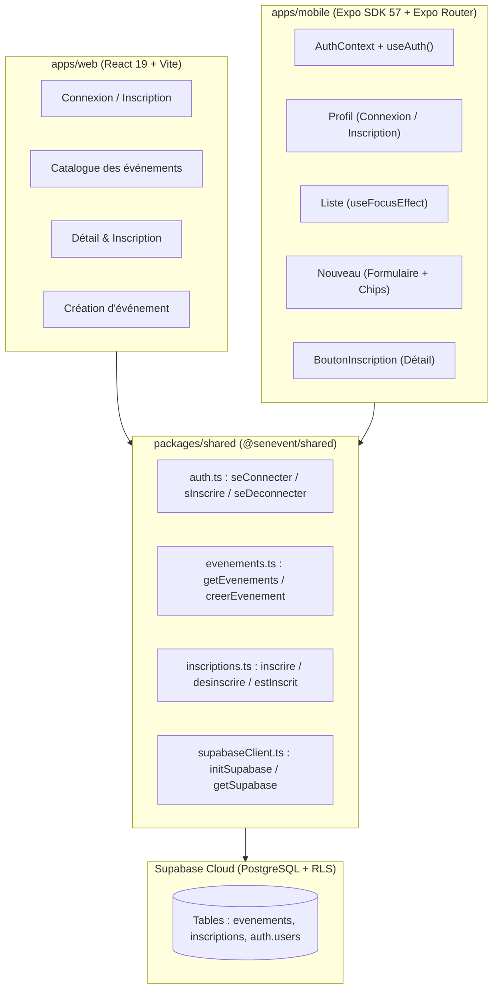

```
========================================================================================
                                RÉPUBLIQUE DU SÉNÉGAL
                     UNIVERSITÉ CHEIKH ANTA DIOP DE DAKAR (UCAD)
                     FACULTÉ DES SCIENCES ET TECHNIQUES (FST)
              DÉPARTEMENT DE MATHÉMATIQUES ET INFORMATIQUE (DMI)
             MASTER 1 RÉSEAUX ET TÉLÉCOMMUNICATIONS (M1 RETEL)
                            ANNÉE : 2025 – 2026

      MODULE : DAWM (DÉVELOPPEMENT D'APPLICATIONS WEB & MOBILE)
      ENSEIGNANT : DR. EL HADJI BASSIROU TOURE (DMI / FST / UCAD)
========================================================================================

                            RAPPORT DE TRAVAUX PRATIQUES
                                      LAB 10
                 AUTHENTIFICATION ET CATALOGUE COMPLET CÔTÉ MOBILE
               « Le mobile rattrape le web — même logique, deux interfaces »

      PROJET : SenEvent (Plateforme Événementielle Partagée Monorepo)
      TAG DE VALIDATION : v0.10-mobile-crud
      BRANCHE GIT : feature/lab10-mobile-crud (fusionnée dans main)

----------------------------------------------------------------------------------------
  PRÉSENTÉ PAR :
    • Ousseynou DIOP (Étudiant M1 RETEL — Auteur des commits & Git Master)
    • Équipe SenEvent : Atou, Mansour NDIAYE, Khady, Ousseynou DIOP

  SOUS LA SUPERVISION DE :
    • Dr. El Hadji Bassirou TOURE (Enseignant-Chercheur, DMI / UCAD)

  DATE DE REMISE : NOVEMBRE 2026
========================================================================================
```

---

# 1. Introduction et Objectifs Pédagogiques

Le **Lab 10** représente l'aboutissement fonctionnel de l'application mobile SenEvent. Avant ce lab, l'application mobile sous Expo Router ne permettait que de consulter les événements en lecture seule (Labs 8 et 9), alors que l'application Web disposait déjà du CRUD complet et de l'authentification (Labs 5 et 6).

Ce Lab 10 réalise l'alignement complet des fonctionnalités sans jamais réécrire de code métier :
1. **Contexte React d'authentification (`AuthContext.js`)** : Partage global de l'état de session sans prop drilling.
2. **Authentification mobile native** : Connexion (`seConnecter`), inscription (`sInscrire`) et déconnexion (`seDeconnecter`) via un formulaire adapté aux contraintes mobiles (`KeyboardAvoidingView`, `TextInput`).
3. **Création d'événements native** : Écran `nouveau.js` avec sélecteur par puces (chips), accessible uniquement aux utilisateurs connectés.
4. **Rafraîchissement intelligent** : Utilisation du hook `useFocusEffect` pour synchroniser la liste au retour sur l'écran.
5. **Gestion des inscriptions** : Composant `BoutonInscription.js` dynamique sur l'écran de détail (`estInscrit`, `inscrire`, `desinscrire`).
6. **Architecture partagée stricte** : Aucun appel direct à Supabase (`supabase.from` / `createClient`) dans `apps/mobile`.

---

# 2. Architecture Technique et Diagramme de Flux



---

# 3. Travaux Réalisés et Code Mis en Œuvre

### Étape 1 : Le contexte d'authentification
- **Fichier créé** : `apps/mobile/context/AuthContext.js`
  - Utilise `createContext({ session: null, chargement: true })`.
  - Écoute les changements d'état d'authentification avec `getSupabase().auth.onAuthStateChange`.
  - Expose le hook personnalisé `useAuth()` pour consommer la session partout dans l'arborescence.
- **Fichier modifié** : `apps/mobile/app/_layout.js`
  - Enveloppe le `Stack` de navigation dans `<AuthProvider>`.
  - Déclare la nouvelle route `nouveau` (`options={{ title: "Nouvel evenement" }}`).

### Étape 2 : L'écran Profil (Connexion & Inscription)
- **Fichier modifié** : `apps/mobile/app/(tabs)/profil.js`
  - Affichage conditionnel : formulaire `FormulaireAuth` si non connecté, informations utilisateur (`session.user.email`) et bouton de déconnexion si connecté.
  - Utilisation de `KeyboardAvoidingView` pour éviter que le clavier virtuel ne recouvre les champs de saisie.

### Étape 3 : Création d'événements depuis le mobile
- **Bouton d'en-tête** : `apps/mobile/app/(tabs)/_layout.js` intègre `BoutonAjouter` dans le `headerRight` de l'onglet Événements (visible uniquement si l'utilisateur est authentifié).
- **Écran de création** : `apps/mobile/app/nouveau.js` avec sélecteur de catégories en chips (`concert`, `expo`, `conference`, `atelier`, `soutenance`) et appel à `creerEvenement(...)`.
- **Rafraîchissement** : `apps/mobile/app/(tabs)/index.js` implémente `useFocusEffect(useCallback(...))` pour recharger les événements dès que l'écran reprend le focus.

### Étape 4 : Inscription à un événement
- **Fichier créé** : `apps/mobile/components/BoutonInscription.js`
  - Vérifie le statut d'inscription en temps réel avec `estInscrit(evenementId, session.user.id)`.
  - Permet l'inscription (`inscrire`) et la désinscription (`desinscrire`).
- **Fichier modifié** : `apps/mobile/app/evenement/[id].js` pour intégrer ce bouton sous les détails.

---

# 4. Captures d'Écran et Interfaces Réalisées

### Interface Mobile (Aperçus Visuels)

```
+-----------------------------------+     +-----------------------------------+
| Evenements                      + |     | Nouvel evenement                  |
+-----------------------------------+     +-----------------------------------+
|                                   |     | Titre                             |
|  +-----------------------------+  |     | [ Gala Annuel RETEL 2026        ] |
|  | CONCERT                     |  |     |                                   |
|  | Concert Live Dakar 2026     |  |     | Categorie                         |
|  | Grand Theatre National      |  |     | (concert) [expo] [conf] [atelier] |
|  | 5 000 FCFA                  |  |     |                                   |
|  +-----------------------------+  |     | Lieu                              |
|                                   |     | [ UCAD II, Dakar                ] |
|  +-----------------------------+  |     |                                   |
|  | EXPO                        |  |     | Prix (FCFA, 0 = gratuit)          |
|  | Biennale Dak'Art            |  |     | [ 2500                          ] |
|  | Musée Théodore Monod        |  |     |                                   |
|  | Gratuit                     |  |     | +-------------------------------+ |
|  +-----------------------------+  |     | |      Ajouter l'evenement      | |
|                                   |     | +-------------------------------+ |
+-----------------------------------+     +-----------------------------------+
|  [Evenements]          [Profil]   |     |  [Evenements]          [Profil]   |
+-----------------------------------+     +-----------------------------------+
```

```
+-----------------------------------+     +-----------------------------------+
| Profil                            |     | Detail                            |
+-----------------------------------+     +-----------------------------------+
|                                   |     |                                   |
|            Mon profil             |     | Gala Annuel RETEL 2026            |
|                                   |     | CONCERT                           |
|     ousseynoudiopcoki@gmail.com   |     | Lieu : UCAD II, Dakar             |
|                                   |     | Date : 15/12/2026                 |
|  +-----------------------------+  |     | Prix : 2500 FCFA                  |
|  |       Se deconnecter        |  |     |                                   |
|  +-----------------------------+  |     |  +-----------------------------+  |
|                                   |     |  | S'inscrire a cet evenement  |  |
|                                   |     |  +-----------------------------+  |
|                                   |     |    (Bascule: "Se desinscrire")    |
+-----------------------------------+     +-----------------------------------+
|  [Evenements]          [Profil]   |     |  [Evenements]          [Profil]   |
+-----------------------------------+     +-----------------------------------+
```

---

# 5. Preuves d'Exécution et Vérification Côté Enseignant

```bash
$ git log v0.9-router..v0.10-mobile-crud --oneline
252e98d bouton d'inscription a un evenement sur mobile
256d168 creation d'evenement mobile + bouton header + refresh au focus
0d06d3d ecran Profil : connexion, inscription, deconnexion mobile
144045c contexte d'authentification (AuthProvider + useAuth)

$ git grep -E "supabase\.from|createClient" apps/mobile
# Sortie vide (code 1) : 0 correspondance ! Aucun appel direct à Supabase dans le mobile.

$ test -f apps/mobile/context/AuthContext.js && echo "OK"
OK

$ grep -rl "creerEvenement\|inscrire\|seConnecter" apps/mobile
apps/mobile/app/(tabs)/profil.js
apps/mobile/app/nouveau.js
apps/mobile/components/BoutonInscription.js
```

---

# 6. Checklist de Validation du Lab 10

| Critère exigé par l'énoncé | État | Justification technique |
|---|:---:|---|
| `context/AuthContext.js` créé | **Validé** | Expose `AuthProvider` et `useAuth` |
| `app/_layout.js` enveloppé | **Validé** | `AuthProvider` au sommet de l'arborescence |
| Formulaire profil natif | **Validé** | `TextInput` + `KeyboardAvoidingView` |
| Connexion / Inscription | **Validé** | Appelle `seConnecter` / `sInscrire` du package partagé |
| Bouton `+` en-tête | **Validé** | Conditionné à la session active |
| Écran `nouveau.js` | **Validé** | Validation titre ≥ 3 car., chips catégories, `creerEvenement` |
| Rafraîchissement focus | **Validé** | `useFocusEffect(useCallback(...))` dans `(tabs)/index.js` |
| Inscription au détail | **Validé** | `BoutonInscription.js` avec bascule dynamique |
| Règle du Monorepo | **Validé** | 0 appel Supabase direct dans le mobile |
| Tag officiel posé | **Validé** | `v0.10-mobile-crud` posé sur `main` et poussé sur GitHub |
