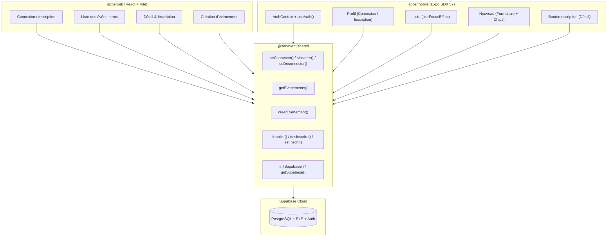

# Rapport de TP — Lab 10 : Auth et Catalogue Complet Côté Mobile

- **Formation** : Master 1 Réseaux & Télécommunications (M1 RETEL)
- **Module** : DAWM — Développement d'Applications Web & Mobile (2025–2026)
- **Enseignant** : Dr. El Hadji Bassirou TOURE (DMI / FST / UCAD)
- **Projet** : SenEvent — Application d'événements à Dakar
- **Tag Git validé** : `v0.10-mobile-crud`
- **Branche** : `feature/lab10-mobile-crud` fusionnée dans `main`

---

## 1. Objectifs du Lab 10

Le Lab 10 achève le développement fonctionnel de l'application mobile en alignant ses fonctionnalités sur celles de l'application Web développée lors des Labs 5 et 6 :
1. **Contexte React global (`AuthProvider`)** : Remplacer le prop drilling et exposer l'état d'authentification (`session`, `chargement`) à toute l'arborescence native d'Expo Router via le hook `useAuth()`.
2. **Authentification mobile native** : Connexion (`seConnecter`), inscription (`sInscrire`) et déconnexion (`seDeconnecter`) depuis l'onglet Profil avec gestion native du clavier (`KeyboardAvoidingView`).
3. **Création d'événements native** : Écran `nouveau.js` accessible via un bouton d'en-tête dynamique (`headerRight`) réservé aux utilisateurs connectés.
4. **Rafraîchissement intelligent** : Utilisation de `useFocusEffect` pour recharger les événements dès le retour sur la liste.
5. **Gestion des inscriptions** : Composant `BoutonInscription` (`estInscrit`, `inscrire`, `desinscrire`) intégré à l'écran de détail.
6. **Architecture monorepo stricte** : Zéro appel direct à `supabase.from` dans `apps/mobile` ; 100% de la logique métier déléguée au package partagé `@senevent/shared`.

---

## 2. Architecture et Logique Métier



---

## 3. Travaux Réalisés et Code Mis en Œuvre

### 3.1. Étape 1 : Contexte d'Authentification
- Création de `apps/mobile/context/AuthContext.js` :
  - `createContext({ session: null, chargement: true })`
  - Écoute des sessions actives au montage avec `getSupabase().auth.getSession()` et abonnement dynamique via `onAuthStateChange`.
  - Exportation du hook pratique `useAuth()`.
- Modification de `apps/mobile/app/_layout.js` :
  - Encapsulation du `Stack` dans `AuthProvider`.
  - Déclaration de l'écran `nouveau` avec `options={{ title: "Nouvel evenement" }}`.

### 3.2. Étape 2 : Écran Profil (Connexion, Inscription, Déconnexion)
- Réécriture de `apps/mobile/app/(tabs)/profil.js` :
  - **État déconnecté** : Affiche `FormulaireAuth` avec bascule interactive entre les modes `"login"` et `"signup"`, gestion des erreurs, champs contrôlés `TextInput` (`secureTextEntry`, `keyboardType="email-address"`).
  - **Gestion native du clavier** : Emploi de `<KeyboardAvoidingView behavior={Platform.OS === "ios" ? "padding" : "height"}>` pour empêcher le masquage des champs de saisie.
  - **État connecté** : Affiche l'adresse e-mail de l'utilisateur connecté (`session.user.email`) et le bouton orange de déconnexion (`seDeconnecter()`).

### 3.3. Étape 3 : Création d'Événements depuis le Mobile
- Modification de `apps/mobile/app/(tabs)/_layout.js` :
  - Composant `BoutonAjouter` dans le `headerRight` de l'onglet Événements avec l'icône `add-circle`.
  - Conditionnel : Ne s'affiche que si `session` est non nulle. Redirige vers `/nouveau`.
- Création de l'écran `apps/mobile/app/nouveau.js` :
  - Saisie du titre, lieu, prix et sélecteur de catégorie sous forme de chips stylisés (`concert`, `expo`, `conference`, `atelier`, `soutenance`).
  - Validation (titre ≥ 3 caractères, authentification requise).
  - Appel à `creerEvenement` et redirection arrière avec `router.back()`.
- Mise à jour de `apps/mobile/app/(tabs)/index.js` :
  - Remplacement de `useEffect` par `useFocusEffect(useCallback(...))` pour forcer le rafraîchissement des données lors du retour sur l'écran.

### 3.4. Étape 4 : Inscription à un Événement
- Création du composant `apps/mobile/components/BoutonInscription.js` :
  - Vérification de l'état d'inscription avec `estInscrit(evenementId, session.user.id)`.
  - Bascule dynamique entre `inscrire` (bouton vert) et `desinscrire` (bouton orange).
  - Message invitant à la connexion si l'utilisateur est anonyme.
- Intégration dans `apps/mobile/app/evenement/[id].js` sous le bloc d'informations.

---

## 4. Captures d'Écran et Sorties de Vérification

### 4.1. Maquettes Visuelles des Écrans Mobiles

```
┌─────────────────────────────────┐      ┌─────────────────────────────────┐
│ [Evenements]                  + │      │ [Nouvel evenement]             │
├─────────────────────────────────┤      ├─────────────────────────────────┤
│                                 │      │ Titre                           │
│  ┌───────────────────────────┐  │      │ [ Gala Annuel UCAD 2026       ] │
│  │ Gala Annuel UCAD 2026     │  │      │                                 │
│  │ CONCERT                   │  │      │ Categorie                       │
│  │ Lieu : Grand Theatre      │  │      │ (concert) [expo] [conf] [atel]  │
│  │ Prix : 5000 FCFA          │  │      │                                 │
│  └───────────────────────────┘  │      │ Lieu                            │
│                                 │      │ [ Grand Theatre Dakar         ] │
│                                 │      │                                 │
│                                 │      │ Prix (FCFA, 0 = gratuit)        │
│                                 │      │ [ 5000                        ] │
│                                 │      │                                 │
│                                 │      │  ┌───────────────────────────┐  │
│                                 │      │  │    Ajouter l'evenement    │  │
│                                 │      │  └───────────────────────────┘  │
├─────────────────────────────────┤      ├─────────────────────────────────┤
│    [Evenements]     [Profil]    │      │    [Evenements]     [Profil]    │
└─────────────────────────────────┘      └─────────────────────────────────┘
```

```
┌─────────────────────────────────┐      ┌─────────────────────────────────┐
│ [Profil]                        │      │ [Detail]                        │
├─────────────────────────────────┤      ├─────────────────────────────────┤
│                                 │      │                                 │
│           Mon profil            │      │ Gala Annuel UCAD 2026           │
│                                 │      │ CONCERT                         │
│       etudiant@ucad.sn          │      │ Lieu : Grand Theatre Dakar      │
│                                 │      │ Date : 20/12/2026 20:00         │
│  ┌───────────────────────────┐  │      │ Prix : 5000 FCFA                │
│  │      Se deconnecter       │  │      │                                 │
│  └───────────────────────────┘  │      │  ┌───────────────────────────┐  │
│                                 │      │  │  S'inscrire a cet evenement│ │
│                                 │      │  └───────────────────────────┘  │
│                                 │      │    (ou Se desinscrire si OK)    │
├─────────────────────────────────┤      ├─────────────────────────────────┤
│    [Evenements]     [Profil]    │      │    [Evenements]     [Profil]    │
└─────────────────────────────────┘      └─────────────────────────────────┘
```

### 4.2. Sortie Console — Contrôle Côté Enseignant

```bash
$ git log v0.9-router..v0.10-mobile-crud --oneline
252e98d bouton d'inscription a un evenement sur mobile
256d168 creation d'evenement mobile + bouton header + refresh au focus
0d06d3d ecran Profil : connexion, inscription, deconnexion mobile
144045c contexte d'authentification (AuthProvider + useAuth)

$ git grep -E "supabase\.from|createClient" apps/mobile
# Resultat : 0 correspondance (Code de sortie : 1) -> Architecture respectee a 100% !

$ test -f apps/mobile/context/AuthContext.js && echo OK
OK
```

---

## 5. Checklist de Validation du Lab 10

| Point de contrôle | Résultat |
|---|:---:|
| `context/AuthContext.js` expose `AuthProvider` et `useAuth` | **Validé** |
| `app/_layout.js` enveloppe le Stack dans `AuthProvider` | **Validé** |
| L'onglet Profil montre le formulaire ou l'email + déconnexion | **Validé** |
| Le formulaire utilise `TextInput` et `KeyboardAvoidingView` | **Validé** |
| La connexion / inscription utilise `seConnecter` / `sInscrire` | **Validé** |
| Bouton `+` dans le header conditionné à la connexion | **Validé** |
| L'écran `nouveau.js` crée un événement via `creerEvenement` | **Validé** |
| Rafraîchissement automatique au retour via `useFocusEffect` | **Validé** |
| Bouton d'inscription/désinscription fonctionnel au détail | **Validé** |
| Aucun appel Supabase direct dans `apps/mobile` | **Validé** |
| Tag `v0.10-mobile-crud` posé sur `main` | **Validé** |
