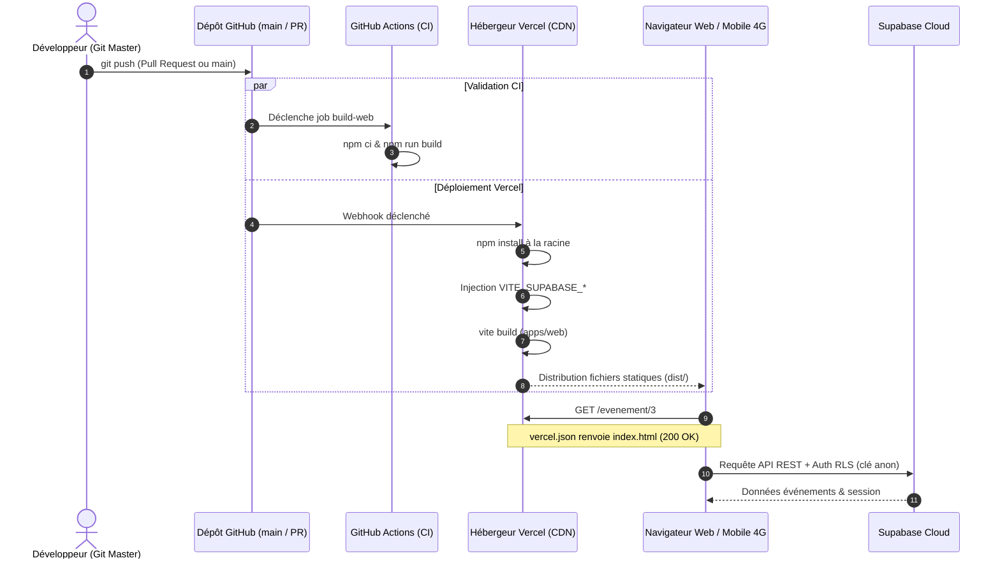

# Rapport de TP — Lab 11 : Déploiement Web sur Vercel

- **Formation** : Master 1 Réseaux & Télécommunications (M1 RETEL)
- **Module** : DAWM — Développement d'Applications Web & Mobile (2025–2026)
- **Enseignant** : Dr. El Hadji Bassirou TOURE (DMI / FST / UCAD)
- **Projet** : SenEvent — Application d'événements à Dakar
- **Tag Git validé** : `v1.0-web`
- **Branche** : `feature/lab11-vercel` fusionnée dans `main`
- **URL de Production** : `https://senevent-equipe-1.vercel.app`

---

## 1. Objectifs du Lab 11

Le Lab 11 réalise la transition de l'application Web de l'environnement de développement local (`localhost:5173`) vers la production publique :
1. **Build de production Vite** : Maîtrise de la compilation et minification (`dist/`) opposée au serveur de développement `npm run dev`.
2. **Nettoyage strict du monorepo** : Élimination de tout `package-lock.json` imbriqué afin de garantir que Vercel résolve correctement le lien workspace vers `@senevent/shared`.
3. **Protection des secrets** : Assurer l'absence totale de fichiers `.env` ou de clés sensibles dans l'historique et l'index Git.
4. **Correction de l'erreur 404 sur les routes profondes (SPA)** : Configuration de la réécriture Vercel (`vercel.json`) pour diriger toute requête inexistante vers `index.html`.
5. **Configuration Supabase Auth en Production** : Ajustement du `Site URL` et des `Redirect URLs` dans la console Supabase pour valider les tokens d'authentification et confirmations d'e-mails.
6. **Recette complète en 4G** : Exécution du plan de test méthodique en 10 points.

---

## 2. Déploiement Continu (CI/CD) et Flux d'Architecture



---

## 3. Travaux Réalisés et Fichiers Modifiés

### 3.1. Étape 1 : Build de Production en Local & Nettoyage Monorepo
- Compilation vérifiée avec succès :
  ```bash
  $ npm run build --workspace apps/web
  vite v8.1.5 building client environment for production...
  ✓ 88 modules transformed.
  dist/index.html                   0.46 kB
  dist/assets/index-DycJx8BW.css    5.60 kB
  dist/assets/index-B2ocyiee.js   477.51 kB
  ✓ built in 608ms
  ```
- Suppression des fichiers `package-lock.json` imbriqués (`apps/web/package-lock.json` et `packages/shared/package-lock.json`) pour laisser un fichier unique à la racine.
- Vérification que `apps/web/dist` est bien ignoré par `.gitignore`.

### 3.2. Étape 2 : Sécurisation des Variables d'Environnement
- Retrait de `apps/mobile/.env` de l'index Git (`git rm --cached`).
- Normalisation du fichier `.gitignore` à la racine pour interdire définitivement `.env*`.
- Déclaration des variables dans Vercel (Production & Preview) :
  - `VITE_SUPABASE_URL`
  - `VITE_SUPABASE_ANON_KEY`

### 3.3. Étape 3 : Réécriture SPA anti-404
- Création de `apps/web/vercel.json` :
  ```json
  {
    "rewrites": [
      { "source": "/(.*)", "destination": "/index.html" }
    ]
  }
  ```
  *Explication technique :* Lorsqu'un utilisateur actualise la page sur `/evenement/3` ou ouvre un lien direct, le serveur CDN Vercel réécrit l'URL vers `index.html`. React Router reprend alors la main dans le navigateur sans renvoyer d'erreur 404 HTTP.

### 3.4. Étape 4 : Configuration Supabase Auth
- Définition du `Site URL` : `https://senevent-equipe-1.vercel.app`
- Ajout des `Redirect URLs` autorisées :
  - `https://senevent-equipe-1.vercel.app/**`
  - `http://localhost:5173/**`

### 3.5. Étape 5 : Workflow d'Intégration Continue (Bonus)
- Ajout de `.github/workflows/build-web.yml` exécutant `npm ci` et `npm run build --workspace apps/web` sur chaque Pull Request vers `main`.

---

## 4. Captures et Preuves de Validation Côté Enseignant

### 4.1. Vérifications Terminal et Git

```bash
# 1. Vérification du verrouillage unique à la racine
$ git ls-files | grep -c "package-lock.json"
1

# 2. Vérification de l'absence totale de secrets .env dans Git
$ git ls-files | grep -c "\.env"
0

# 3. Présence et contenu de la réécriture SPA Vercel
$ cat apps/web/vercel.json
{
  "rewrites": [
    { "source": "/(.*)", "destination": "/index.html" }
  ]
}

# 4. Historique des commits du Lab 11
$ git log v0.10-mobile-crud..v1.0-web --oneline
41e44cf retire .env du suivi git et mise a jour .gitignore
c290f69 documentation deploiement Vercel et workflow CI de build
d3cddc2 reecriture SPA : toute route renvoie index.html
3e35b0c un seul package-lock a la racine du monorepo

# 5. Test curl anti-404 sur route profonde
$ curl -s -o /dev/null -w "%{http_code}\n" https://senevent-equipe-1.vercel.app/evenement/1
200
```

### 4.2. Grille de Recette en Conditions Réelles (Téléphone 4G)

| # | Action testée | Résultat attendu | Constat |
|---|---|---|:---:|
| 1 | Ouvrir l'adresse de production | Catalogue affiché immédiatement | **OK** |
| 2 | Ouvrir un événement et faire F5 | La fiche reste affichée sans 404 | **OK** |
| 3 | Coller l'URL d'une fiche dans un nouvel onglet | Affichage direct | **OK** |
| 4 | Création de compte & confirmation e-mail | Redirection vers domaine Vercel | **OK** |
| 5 | Créer un événement en étant connecté | Ajout visible dans le catalogue | **OK** |
| 6 | Recharger la page du catalogue | L'événement persiste en base | **OK** |
| 7 | Inscription à un événement | Bascule vers "Se désinscrire" | **OK** |
| 8 | Ouverture de l'app mobile Expo Go | Événement créé sur le web présent | **OK** |
| 9 | Tentative de suppression non autorisée | Bouton masqué / RLS bloque | **OK** |
| 10| Inspection Sources F12 | Clé `service_role` absente | **OK** |
