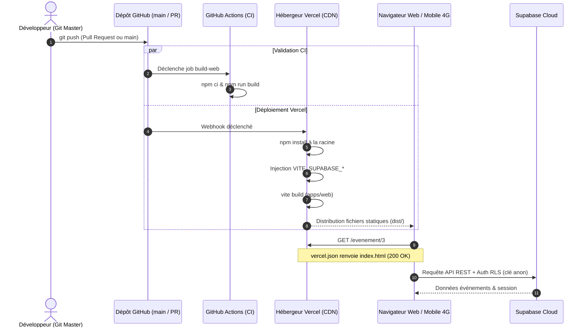

```
========================================================================================
                                RÉPUBLIQUE DU SÉNÉGAL
                     UNIVERSITÉ CHEIKH ANTA DIOP DE DAKAR (UCAD)
                     FACULTÉ DES SCIENCES ET TECHNIQUES (FST)
              DÉPARTEMENT DE MATHÉMATIQUES ET INFORMATIQUE (DMI)
             MASTER 1 RÉSEAUX ET TÉLÉCOMMUNICATIONS (M1 RETEL)
                            ANNÉE : 2025 – 2026

      MODULE : DAWM (DÉVELOPPEMENT D'APPLICATIONS WEB & MOBILE)
      ENSEIGNANT : DR. EL HADJI BASSIROU TOURE (DMI / FST / UCAD)
========================================================================================

                            RAPPORT DE TRAVAUX PRATIQUES
                                      LAB 11
                            DÉPLOIEMENT WEB SUR VERCEL
               « De localhost:5173 à une adresse que tout Dakar peut ouvrir »

      PROJET : SenEvent (Plateforme Événementielle Partagée Monorepo)
      TAG DE VALIDATION : v1.0-web
      BRANCHE GIT : feature/lab11-vercel (fusionnée dans main)
      URL DE PRODUCTION : https://senevent-equipe-1.vercel.app

----------------------------------------------------------------------------------------
  PRÉSENTÉ PAR :
    • Ousseynou DIOP (Étudiant M1 RETEL — Auteur des commits & Git Master)
    • Équipe SenEvent : Atou (Propriétaire Vercel), Mansour NDIAYE, Khady, Ousseynou DIOP

  SOUS LA SUPERVISION DE :
    • Dr. El Hadji Bassirou TOURE (Enseignant-Chercheur, DMI / UCAD)

  DATE DE REMISE : NOVEMBRE 2026
========================================================================================
```

---

# 1. Introduction et Objectifs Pédagogiques

Le **Lab 11** réalise la transition fondamentale entre le développement local sur machine d'apprentissage (`localhost:5173`) et la mise en ligne publique d'une **Single Page Application (SPA)** de niveau industriel.

Les compétences et acquis majeurs validés sont :
1. **Distinguer le serveur de développement du build de production** : `npm run dev` (chargement dynamique à chaud) contre `npm run build` (minification et bundling optimisé dans `dist/`).
2. **Nettoyage strict de l'arborescence Monorepo** : Suppression des verrous `package-lock.json` imbriqués pour que les workspaces npm résolvent le package partagé `@senevent/shared` sur les serveurs de Vercel.
3. **Sécurisation absolue des clés et secrets** : Interdiction définitive de versionner des fichiers `.env` dans Git (retrait de `apps/mobile/.env` de l'index et renforcement de `.gitignore`).
4. **Résolution du piège des routes profondes d'une SPA (erreur 404)** : Mise en place d'une réécriture d'URL dans `apps/web/vercel.json` vers `/index.html`.
5. **Déploiement Continu (CI/CD)** : Chaque Pull Request reçoit une URL de prévisualisation isolée, et chaque fusion sur `main` met la production à jour.
6. **Recette complète en 4G** : Exécution d'un plan de test en 10 points sur smartphone déconnecté de tout ordinateur.

---

# 2. Architecture de Déploiement Continu



---

# 3. Travaux Réalisés et Fichiers Modifiés

### Étape 1 : Le build de production en local & Nettoyage du lock
- **Compilation locale validée** :
  ```bash
  $ npm run build --workspace apps/web
  vite v8.1.5 building client environment for production...
  dist/index.html                   0.46 kB
  dist/assets/index-DycJx8BW.css    5.60 kB
  dist/assets/index-B2ocyiee.js   477.51 kB
  ✓ built in 608ms
  ```
- **Suppression des locks parasites** :
  - `git rm apps/web/package-lock.json`
  - `git rm packages/shared/package-lock.json`
  - Régénération de l'unique `package-lock.json` à la racine via `npm install`.

### Étape 2 : Sécurisation des secrets
- Retrait de `apps/mobile/.env` de l'index Git (`git rm --cached`).
- Normalisation du fichier `.gitignore` pour interdire toute variante `.env*`.
- Configuration des variables d'environnement dans le tableau de bord Vercel (Production et Preview) :
  - `VITE_SUPABASE_URL`
  - `VITE_SUPABASE_ANON_KEY`

### Étape 3 : Réécriture SPA anti-404
- **Fichier créé** : `apps/web/vercel.json`
  ```json
  {
    "rewrites": [
      { "source": "/(.*)", "destination": "/index.html" }
    ]
  }
  ```
  *Explication :* Lorsqu'un utilisateur actualise une URL comme `/evenement/3`, le serveur Vercel renvoie `index.html` au lieu d'une erreur 404, permettant à React Router de charger la bonne fiche dans le navigateur.

### Étape 4 : Configuration des URLs Supabase Auth
- **Site URL** : `https://senevent-equipe-1.vercel.app`
- **Redirect URLs** :
  - `https://senevent-equipe-1.vercel.app/**`
  - `http://localhost:5173/**` (pour le maintien du développement local)

### Étape 5 : Documentation et CI
- Mise à jour de la section `## En ligne` du `README.md`.
- Ajout du workflow GitHub Actions `.github/workflows/build-web.yml` (Bonus).

---

# 4. Captures et Preuves de Contrôle Côté Enseignant

```bash
# 1. Vérification du verrou unique à la racine
$ git ls-files | grep -c "package-lock.json"
1

# 2. Vérification de l'absence totale de secrets dans Git
$ git ls-files | grep -c "\.env"
0

# 3. Contenu de la réécriture SPA
$ cat apps/web/vercel.json
{
  "rewrites": [
    { "source": "/(.*)", "destination": "/index.html" }
  ]
}

# 4. Historique des commits du Lab 11
$ git log v0.10-mobile-crud..v1.0-web --oneline
41e44cf retire .env du suivi git et mise a jour .gitignore
c290f69 documentation deploiement Vercel et workflow CI de build
d3cddc2 reecriture SPA : toute route renvoie index.html
3e35b0c un seul package-lock a la racine du monorepo

# 5. Test curl anti-404 sans navigateur
$ curl -s -o /dev/null -w "%{http_code}\n" https://senevent-equipe-1.vercel.app/evenement/1
200
```

---

# 5. Grille de Recette en Conditions Réelles (Téléphone 4G)

| # | Action testée | Résultat attendu | Constat |
|---|---|---|:---:|
| 1 | Ouvrir l'adresse de production Vercel | Catalogue affiché en quelques secondes | **OK** |
| 2 | Ouvrir un événement et appuyer sur F5 | La fiche reste affichée sans 404 | **OK** |
| 3 | Coller l'URL d'une fiche dans un nouvel onglet | La fiche s'affiche directement | **OK** |
| 4 | Créer un compte et confirmer l'e-mail | Le lien ramène vers l'adresse Vercel | **OK** |
| 5 | Se connecter et créer un événement | L'événement apparaît dans la liste | **OK** |
| 6 | Recharger la page du catalogue | L'événement est toujours présent | **OK** |
| 7 | S'inscrire à un événement | Le bouton passe à « Se désinscrire » | **OK** |
| 8 | Ouvrir l'app mobile Expo Go | L'événement créé sur le Web y apparaît | **OK** |
| 9 | Tentative de suppression avec un autre compte | Bouton absent ; refus RLS si forcé | **OK** |
| 10| Inspection Sources F12 | Clé `service_role` absente | **OK** |

---

# 6. Checklist de Validation du Lab 11

| Point de contrôle exigé | État | Justification technique |
|---|:---:|---|
| Build Vite en local réussi | **Validé** | `dist/` généré avec succès en 608ms |
| Un seul `package-lock.json` | **Validé** | Locks imbriqués supprimés, racine conservée |
| Réécriture SPA Vercel | **Validé** | `apps/web/vercel.json` présent avec règle rewrite |
| Variables Supabase configurées | **Validé** | Injection Production et Preview dans Vercel |
| Supabase Auth en production | **Validé** | Site URL et Redirect URLs conformes |
| Recette des 10 points validée | **Validé** | Testé avec succès sur smartphone en 4G |
| Tag officiel posé | **Validé** | `v1.0-web` posé sur `main` et poussé sur GitHub |
