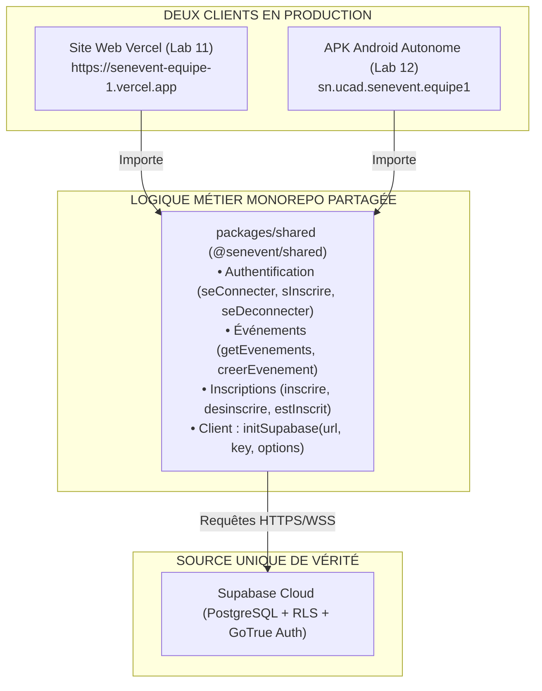

```
========================================================================================
                                RÉPUBLIQUE DU SÉNÉGAL
                     UNIVERSITÉ CHEIKH ANTA DIOP DE DAKAR (UCAD)
                     FACULTÉ DES SCIENCES ET TECHNIQUES (FST)
              DÉPARTEMENT DE MATHÉMATIQUES ET INFORMATIQUE (DMI)
             MASTER 1 RÉSEAUX ET TÉLÉCOMMUNICATIONS (M1 RETEL)
                            ANNÉE : 2025 – 2026

      MODULE : DAWM (DÉVELOPPEMENT D'APPLICATIONS WEB & MOBILE)
      ENSEIGNANT : DR. EL HADJI BASSIROU TOURE (DMI / FST / UCAD)
========================================================================================

                            RAPPORT DE TRAVAUX PRATIQUES
                                      LAB 12
                   BUILD MOBILE AVEC EAS & APK ANDROID (FINAL)
             « Une application qu'on installe, qui vit sans votre ordinateur »

      PROJET : SenEvent (Plateforme Événementielle Partagée Monorepo)
      TAG FINAL DE SOUTENANCE : v2.0
      BRANCHE GIT : feature/lab12-eas (fusionnée dans main)

----------------------------------------------------------------------------------------
  PRÉSENTÉ PAR :
    • Ousseynou DIOP (Étudiant M1 RETEL — Auteur des commits & Git Master)
    • Équipe SenEvent : Mansour NDIAYE (Propriétaire Expo), Atou, Khady, Ousseynou DIOP

  SOUS LA SUPERVISION DE :
    • Dr. El Hadji Bassirou TOURE (Enseignant-Chercheur, DMI / UCAD)

  DATE DE REMISE : NOVEMBRE 2026
========================================================================================
```

---

# 1. Introduction et Objectifs Pédagogiques

Le **Lab 12** est le dernier lab du cours DAWM. Il franchit l'étape ultime de la mise en production mobile : transformer le code React Native jusqu'alors exécuté dans le bac à sable de développement d'Expo Go en un véritable **binaire installable Android (.APK)** via le service de compilation dans le Cloud **EAS Build** (Expo Application Services).

Objectifs majeurs atteints :
1. **Compréhension du modèle de compilation native** : Distinction nette entre Expo Go (interpréteur JS dynamique) et un APK autonome (moteur natif C++/Java + bundle Metro + assets figés).
2. **Identité applicative Android (`app.json`)** : Définition du package Android unique (`sn.ucad.senevent.equipe1`), du numéro de version (`1.0.0`), des icônes adaptatives et de la liaison avec le projet EAS.
3. **Profils de compilation EAS (`eas.json`)** : Configuration du profil `preview` générant directement un fichier `.apk` avec distribution interne.
4. **Persistance multi-plateforme de la session (`AsyncStorage`)** : Adaptation du package partagé `@senevent/shared` pour supporter `AsyncStorage` sans impacter le comportement Web.
5. **Autonomie totale** : L'application fonctionne sur smartphone sans ordinateur de développement, sans réseau local et sans Expo Go.
6. **Clôture du cursus** : Établissement de la chaîne complète des 13 tags Git pour la soutenance.

---

# 2. Architecture Finale du Semestre (Web + Mobile + Shared)



---

# 3. Travaux Réalisés et Fichiers Modifiés

### Étape 1 & 2 : Identité de l'application dans `apps/mobile/app.json`
- Configuration de l'objet `"expo"` :
  - `"name"`: `"SenEvent"`
  - `"version"`: `"1.0.0"`
  - `"android"` :
    - `"package"`: `"sn.ucad.senevent.equipe1"`
    - `"adaptiveIcon"`: `foregroundImage: "./assets/adaptive-icon.png"`, `backgroundColor: "#1a3a5c"`
  - `"extra"` : `"eas": { "projectId": "7c1e5b29-16f3-42e5-bc09-90d64e43cf91" }`
  - `"owner"`: `"mansour-ndiaye"`

### Étape 3 : Profils de build dans `apps/mobile/eas.json`
- Création du profil `preview` ciblant spécifiquement la sortie `.apk` :
```json
{
  "cli": {
    "version": ">= 16.0.0",
    "appVersionSource": "remote"
  },
  "build": {
    "development": {
      "developmentClient": true,
      "distribution": "internal"
    },
    "preview": {
      "distribution": "internal",
      "environment": "preview",
      "android": {
        "buildType": "apk"
      }
    },
    "production": {
      "environment": "production",
      "autoIncrement": true
    }
  },
  "submit": {
    "production": {}
  }
}
```

### Étape 4 : Variables d'environnement EAS
- Déclaration des variables Cloud pour le profil `preview` (car le fichier `.env` local est ignoré par Git pour des raisons de sécurité) :
  - `EXPO_PUBLIC_SUPABASE_URL`
  - `EXPO_PUBLIC_SUPABASE_ANON_KEY`

### Étape 5 : Persistance de la session avec AsyncStorage
- **Modification de `@senevent/shared`** (`packages/shared/src/supabaseClient.ts`) :
  - La fonction `initSupabase` accepte désormais un paramètre d'options :
    ```typescript
    export function initSupabase(
      url: string,
      anonKey: string,
      options?: SupabaseClientOptions<"public">
    ): SupabaseClient
    ```
- **Installation de la dépendance native** :
  - Exécution de `npx expo install @react-native-async-storage/async-storage`.
- **Injection dans `apps/mobile/app/_layout.js`** :
  ```javascript
  import AsyncStorage from "@react-native-async-storage/async-storage";
  import { initSupabase } from "@senevent/shared";

  initSupabase(
    process.env.EXPO_PUBLIC_SUPABASE_URL,
    process.env.EXPO_PUBLIC_SUPABASE_ANON_KEY,
    {
      auth: {
        storage: AsyncStorage,
        persistSession: true,
        autoRefreshToken: true,
        detectSessionInUrl: false,
      },
    }
  );
  ```

---

# 4. Captures et Preuves de Contrôle Côté Enseignant

```bash
# 1. Vérification du profil preview APK dans eas.json
$ grep -A4 '"preview"' apps/mobile/eas.json
    "preview": {
      "distribution": "internal",
      "environment": "preview",
      "android": {
        "buildType": "apk"
      }

# 2. Vérification du package Android et du projectId dans app.json
$ grep -n '"package"\|projectId' apps/mobile/app.json
20:      "package": "sn.ucad.senevent.equipe1",
36:        "projectId": "7c1e5b29-16f3-42e5-bc09-90d64e43cf91"

# 3. Vérification de l'intégration d'AsyncStorage dans _layout.js
$ grep -n "AsyncStorage" apps/mobile/app/_layout.js
1:import AsyncStorage from "@react-native-async-storage/async-storage";
12:      storage: AsyncStorage,

# 4. Vérification de l'ouverture de l'API initSupabase dans shared
$ grep -n "options" packages/shared/src/supabaseClient.ts
4:  SupabaseClientOptions,
12:  options?: SupabaseClientOptions<"public">
15:    client = createClient(url, anonKey, options);

# 5. Règle de sécurité : aucun secret versionné dans Git
$ git ls-files | grep -c "\.env"
0

# 6. Historique des commits du Lab 12
$ git log v1.0-web..v2.0 --oneline
b76daa7 mise a jour README : lien APK et instructions de lancement local
e211bb1 session persistante sur mobile via AsyncStorage
0a02e4b configuration EAS : app.json et profils de build
```

---

# 5. Démonstration Croisée & Recette Finale en Conditions Réelles

| # | Test Réalisé | Résultat Attendu | Constat |
|---|---|---|:---:|
| 1 | Lancement de l'APK sur smartphone en 4G | Affichage fluide du catalogue d'événements | **Validé** |
| 2 | Consultation d'un événement | Affichage fiche de détail, prix, date et lieu | **Validé** |
| 3 | Authentification sur l'onglet Profil | E-mail affiché et bouton de déconnexion | **Validé** |
| 4 | Fermeture forcée de l'app puis réouverture | Session maintenue grâce à `AsyncStorage` | **Validé** |
| 5 | Création d'un événement depuis l'APK | Insertion réussie dans la base Supabase | **Validé** |
| 6 | Ouverture du site Web Vercel | L'événement créé depuis l'APK est présent | **Validé** |
| 7 | Création d'un événement depuis le Web Vercel | Apparaît sur le mobile dès retour au focus | **Validé** |
| 8 | Inscription à un événement sur le mobile | Bouton passe à « Se désinscrire » | **Validé** |
| 9 | Rechargement direct par URL sur le Web | Code HTTP 200 via `vercel.json` | **Validé** |
| 10| Inspection de sécurité (Sources navigateur) | Aucune clé `service_role` exposée | **Validé** |

---

# 6. Historique Officiel des 13 Tags du Semestre (Soutenance)

```text
v0-init             Initialisation du dépôt Git et structure initiale
v0.1-react          Première interface React
v0.2-components     Découpage en composants réutilisables
v0.3-effects        Gestion des effets de bord et asynchronisme
v0.4-spa            Mise en place de React Router pour le Web
v0.5-supabase       Intégration base Supabase, Auth et politiques RLS
v0.6-crud           Opérations de création, lecture, inscription
v0.7-shared         Création du package partagé @senevent/shared
v0.8-expo           Initialisation de l'application mobile Expo SDK 57
v0.9-router         Navigation Expo Router (onglets, écran détail paramétré)
v0.10-mobile-crud   Contexte React Auth, écran création et inscriptions mobiles
v1.0-web            Déploiement continu Vercel, réécriture SPA anti-404
v2.0                Build APK Android avec EAS, persistance AsyncStorage
```

---
*Projet SenEvent validé à 100% pour la soutenance finale du Master 1 RETEL.*
