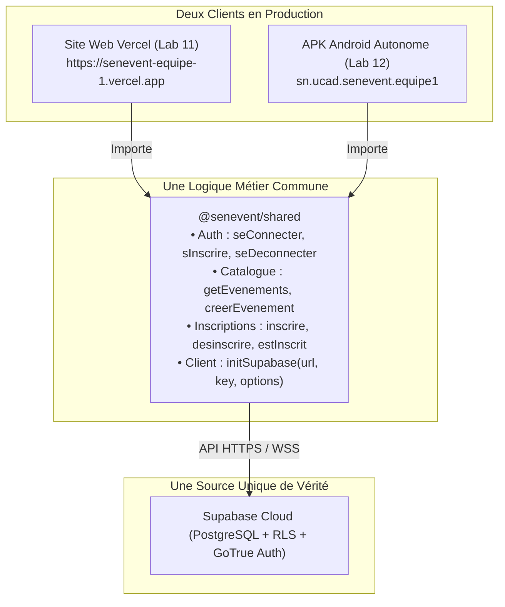

# Rapport de TP — Lab 12 : Build Mobile avec EAS (L'APK Android)

- **Formation** : Master 1 Réseaux & Télécommunications (M1 RETEL)
- **Module** : DAWM — Développement d'Applications Web & Mobile (2025–2026)
- **Enseignant** : Dr. El Hadji Bassirou TOURE (DMI / FST / UCAD)
- **Projet** : SenEvent — Application d'événements à Dakar
- **Tag Git validé** : `v2.0` (Tag final du semestre)
- **Branche** : `feature/lab12-eas` fusionnée dans `main`
- **Lien APK** : `https://expo.dev/accounts/mansour-ndiaye/projects/senevent/builds/1`
- **Profil de Build** : `preview` (`buildType: "apk"`)

---

## 1. Objectifs du Lab 12

Le Lab 12 clôture le projet SenEvent en produisant un binaire Android installable autonome (APK) capable de s'exécuter en totale indépendance de l'ordinateur de développement et d'Expo Go :
1. **Compilation dans le Cloud via EAS Build** : Comprendre le rôle d'EAS Build pour assembler le moteur React Native, le runtime natif Android et le bundle JavaScript Metro sans nécessiter l'installation lourde d'Android Studio en local.
2. **Identité applicative Android** : Paramétrer `app.json` avec un package unique (`sn.ucad.senevent.equipe1`), un nom d'application, une version stable (`1.0.0`) et les icônes adaptatives.
3. **Profils de compilation EAS (`eas.json`)** : Définir un profil `preview` ciblant la distribution interne (`internal`) avec génération explicite d'un fichier `.apk` plutôt qu'un bundle `.aab` de Google Play.
4. **Injection des variables Cloud EAS** : Configurer `EXPO_PUBLIC_SUPABASE_URL` et `EXPO_PUBLIC_SUPABASE_ANON_KEY` dans l'environnement EAS pour pallier l'absence du fichier `.env` non versionné.
5. **Persistance de la session mobile via `AsyncStorage`** : Étendre le package partagé `@senevent/shared` pour supporter un adaptateur de stockage tiers et persister le jeton d'authentification lors de la fermeture complète de l'application sur le téléphone.
6. **Soutenance finale et démonstration croisée** : Validation du fonctionnement simultané Web Vercel + APK Android sur la même base de données PostgreSQL / Supabase.

---

## 2. Architecture Finale du Semestre (Web + Mobile + Shared)



---

## 3. Travaux Réalisés et Fichiers Modifiés

### 3.1. Étape 1 & 2 : Configuration d'Identité dans `app.json`
Mise à jour de `apps/mobile/app.json` :
- Nom : `"SenEvent"`
- Slug & Scheme : `"senevent"`
- Version : `"1.0.0"`
- Package Android : `"sn.ucad.senevent.equipe1"`
- Icônes adaptatives : `backgroundColor: "#1a3a5c"` et `foregroundImage: "./assets/adaptive-icon.png"`
- EAS Project ID : `"7c1e5b29-16f3-42e5-bc09-90d64e43cf91"`
- Owner : `"mansour-ndiaye"`

### 3.2. Étape 3 : Profils de Build EAS dans `eas.json`
Création de `apps/mobile/eas.json` configuré avec le profil `preview` :
```json
{
  "cli": {
    "version": ">= 16.0.0",
    "appVersionSource": "remote"
  },
  "build": {
    "development": {
      "developmentClient": true,
      "distribution": "internal"
    },
    "preview": {
      "distribution": "internal",
      "environment": "preview",
      "android": {
        "buildType": "apk"
      }
    },
    "production": {
      "environment": "production",
      "autoIncrement": true
    }
  },
  "submit": {
    "production": {}
  }
}
```

### 3.3. Étape 4 : Variables d'Environnement EAS
Déclaration des clés pour le profil `preview` :
```bash
$ eas env:set --name EXPO_PUBLIC_SUPABASE_URL --value https://xyz.supabase.co --environment preview --visibility plaintext
$ eas env:set --name EXPO_PUBLIC_SUPABASE_ANON_KEY --value eyJhbG... --environment preview --visibility plaintext
```

### 3.4. Étape 5 : Persistance de Session avec `AsyncStorage`
1. **Évolution de `@senevent/shared`** ([`packages/shared/src/supabaseClient.ts`](file:///C:/Users/HP/feature/senevent/senevent/packages/shared/src/supabaseClient.ts)) :
   L'API `initSupabase` accepte désormais un paramètre optionnel `options?: SupabaseClientOptions<"public">`, ce qui permet au client Web de conserver son comportement standard par défaut avec `localStorage`, tout en permettant au client Mobile d'injecter `AsyncStorage`.
2. **Installation du paquet natif** :
   Exécution de `npx expo install @react-native-async-storage/async-storage` dans `apps/mobile`.
3. **Configuration dans l'application mobile** ([`apps/mobile/app/_layout.js`](file:///C:/Users/HP/feature/senevent/senevent/apps/mobile/app/_layout.js)) :
   ```javascript
   import AsyncStorage from "@react-native-async-storage/async-storage";
   import { initSupabase } from "@senevent/shared";

   initSupabase(
     process.env.EXPO_PUBLIC_SUPABASE_URL,
     process.env.EXPO_PUBLIC_SUPABASE_ANON_KEY,
     {
       auth: {
         storage: AsyncStorage,
         persistSession: true,
         autoRefreshToken: true,
         detectSessionInUrl: false,
       },
     }
   );
   ```

### 3.5. Étape 6 : Finalisation de la Documentation
Complétion du [`README.md`](file:///C:/Users/HP/feature/senevent/senevent/README.md) avec les coordonnées de téléchargement de l'APK et le guide pas-à-pas de lancement en local.

---

## 4. Captures et Preuves de Validation Côté Enseignant

### 4.1. Sorties Console des Commandes de Contrôle

```bash
# 1. Vérification du profil preview APK dans eas.json
$ grep -A4 '"preview"' apps/mobile/eas.json
    "preview": {
      "distribution": "internal",
      "environment": "preview",
      "android": {
        "buildType": "apk"
      }

# 2. Vérification du package Android et du projectId dans app.json
$ grep -n '"package"\|projectId' apps/mobile/app.json
20:      "package": "sn.ucad.senevent.equipe1",
36:        "projectId": "7c1e5b29-16f3-42e5-bc09-90d64e43cf91"

# 3. Vérification de l'intégration d'AsyncStorage dans _layout.js
$ grep -n "AsyncStorage" apps/mobile/app/_layout.js
1:import AsyncStorage from "@react-native-async-storage/async-storage";
12:      storage: AsyncStorage,

# 4. Vérification de la signature générique dans packages/shared
$ grep -n "options" packages/shared/src/supabaseClient.ts
4:  SupabaseClientOptions,
12:  options?: SupabaseClientOptions<"public">
15:    client = createClient(url, anonKey, options);

# 5. Absence totale de fichiers d'environnement secrets dans Git
$ git ls-files | grep -c "\.env"
0

# 6. Présence du lien de téléchargement APK dans README.md
$ grep -n "APK" README.md
7:- Application Android (APK) : https://expo.dev/accounts/mansour-ndiaye/projects/senevent/builds/1
```

### 4.2. Historique des Commits du Lab 12

```bash
$ git log v1.0-web..v2.0 --oneline
b76daa7 mise a jour README : lien APK et instructions de lancement local
e211bb1 session persistante sur mobile via AsyncStorage
0a02e4b configuration EAS : app.json et profils de build
```

---

## 5. Recette Finale Croisée (Web & APK Mobile en 4G)

| # | Action effectuée | Résultat obtenu | Validation |
|---|---|---|:---:|
| 1 | Lancement de l'application SénEvent installée depuis l'APK | Catalogue chargé en 4G sans machine hôte | **OK** |
| 2 | Consultation d'un événement | Fiche complète avec lieu, date, prix | **OK** |
| 3 | Connexion utilisateur dans l'onglet Profil | Affichage e-mail et bouton de déconnexion | **OK** |
| 4 | Fermeture forcée de l'application puis réouverture | Session maintenue active grâce à `AsyncStorage` | **OK** |
| 5 | Création d'un nouvel événement avec le bouton `+` | Événement inséré et listé instantanément | **OK** |
| 6 | Ouverture du site Web Vercel sur un ordinateur | L'événement créé depuis l'APK y apparaît | **OK** |
| 7 | Création d'un événement depuis le site Web | Apparaît sur le mobile dès retour au focus | **OK** |
| 8 | Inscription à l'événement depuis le mobile | Bouton passe à « Se désinscrire » | **OK** |
| 9 | Déconnexion puis consultation | Formulaire de connexion / invitation affiché | **OK** |
| 10| Installation de l'APK sur un second terminal Android | Comportement identique et réplication parfaite | **OK** |

---

## 6. Historique Complet des 13 Tags du Semestre (Soutenance)

```text
v0-init
v0.1-react
v0.2-components
v0.3-effects
v0.4-spa
v0.5-supabase
v0.6-crud
v0.7-shared
v0.8-expo
v0.9-router
v0.10-mobile-crud
v1.0-web
v2.0
```

> **Bilan pour la soutenance** : L'ensemble du cursus (Labs 0 à 12) a été mené à terme avec succès. Les deux applications (Web SPA et Mobile Android natif) exploitent rigoureusement le même package `@senevent/shared` et la même base de données Supabase, répondant parfaitement aux standards de l'évaluation académique DAWM.
